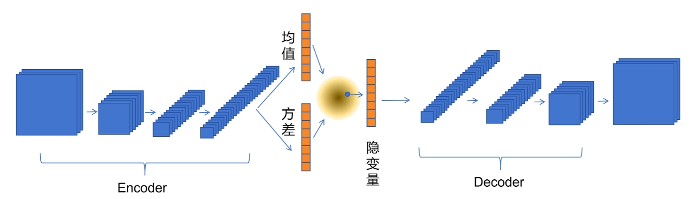

# 周报 - 2026.10.12 - 2026.10.18
---
# 一、本周核心工作/学习内容

## 文献阅读

- 【论文】（提出了基于扩散模型的生成式隐写的安全性问题） —— [*Rethinking Security of Diffusion-based Generative Steganography*](../../papers/week10/paper1.md)

## 基础学习

### VAE

_参考 [VAE算法讲解 （变分自编码器 Variational Auto-Encoder）](https://www.bilibili.com/video/BV1xFxMz1EMS/?share_source=copy_web&vd_source=dcedb729c1920a524ddace9deca746fd)_

VAE 的核心思想：把图片压缩成一个概率分布，并让这些分布整体上规整地铺在潜空间里，基本实现如下：

1. **编码**：每张图 $x$ 不是映射到一个点，而是映射到一个分布 $q(z|x)$（高斯）。
2. **正则**：用 KL 散度把这些分布拉向标准正态先验 $N(0,I)$，让潜空间连续、平滑、可采样。
3. **解码**：从分布里采样 $z$，解码器还原出图片分布；重构损失保证信息不丢。

一句话就是用概率分布做有损压缩，一边重构、一边把潜空间规整成标准正态，从而既能压缩又能生成。

首先是数据集的处理

```python
transform = transforms.Compose([
    transforms.Resize(image_size),
    transforms.CenterCrop(image_size),
    transforms.ToTensor(),
])

class My_Dataset(Dataset):
    def __init__(self, root, transform=None):
        self.root = root
        self.paths = sorted(glob.glob(os.path.join(root, "*.jpg")))
        self.transform = transform

    def __len__(self):
        return len(self.paths)

    def __getitem__(self, idx):
        img_path = self.paths[idx]
        img = Image.open(img_path).convert("RGB")
        if self.transform:
            img = self.transform(img)
        return img


imgs_path = "../../../datas/flickr8k/images"
dataset = My_Dataset(root=imgs_path, transform=transform)
loader = DataLoader(dataset, batch_size=10, shuffle=True,
                    num_workers=4, pin_memory=True)

for batch_idx, imgs in enumerate(loader):
    print(f'Batch {batch_idx + 1}:')
    print(f'Image: {imgs}')
    break
```

本示例使用的模型结构图：



```python
class ConvVAE(nn.Module):
    def __init__(self, latent_dim=128, ch=64, image_size=64):
        super().__init__()
        self.latent_dim = latent_dim    # 隐变量维度
        self.ch = ch    # 初始卷积通道数
        self.image_size = image_size    # 输入图片的大小

        # 编码器 Encoder 
        self.enc = nn.Sequential(
            nn.Conv2d(3, ch, 4, 2, 1),  # 每个维度宽高/2，变化初始维度
            nn.ReLU(True),
            nn.Conv2d(ch, ch * 2, 4, 2, 1), # 维度数加倍，每个维度宽高/2
            nn.BatchNorm2d(ch * 2),
            nn.ReLU(True),
            nn.Conv2d(ch * 2, ch * 4, 4, 2, 1), # 同样的下采样
            nn.BatchNorm2d(ch * 4),
            nn.ReLU(True),
            nn.Conv2d(ch * 4, ch * 8, 4, 2, 1),
            nn.BatchNorm2d(ch * 8),
            nn.ReLU(True)
        )

        # 得到编码器处理后平展的特征维度大小 feat_dim
        with torch.no_grad():
            dummy = torch.zeros(1, 3, image_size, image_size)
            feat_dim = self.enc(dummy).view(1, -1).size(1)

        self.fc_mu = nn.Linear(feat_dim, latent_dim)    # 得到隐变量的均值
        self.fc_logvar = nn.Linear(feat_dim, latent_dim)    # 得到隐变量的方差
        self.fc_dec = nn.Linear(latent_dim, feat_dim)   # 隐变量转换为特征变量

        self._feat_shape = self.enc(dummy).shape[1:]    # 编码器最后一层卷积输出的维度

        # 解码器 Decoder 编码器的逆过程
        self.dec = nn.Sequential(
            nn.ConvTranspose2d(ch * 8, ch * 4, 4, 2, 1),
            nn.BatchNorm2d(ch * 4),
            nn.ReLU(True),
            nn.ConvTranspose2d(ch * 4, ch * 2, 4, 2, 1),
            nn.BatchNorm2d(ch * 2),
            nn.ReLU(True),
            nn.ConvTranspose2d(ch * 2, ch, 4, 2, 1),
            nn.BatchNorm2d(ch),
            nn.ReLU(True),
            nn.ConvTranspose2d(ch, 3, 4, 2, 1),
            nn.Sigmoid()  # 添加Sigmoid激活 将图片像素值归一化到[0,1]
        )

    # 编码过程 通过编码器编码得到均值和方差 用于采样隐变量
    def encode(self, x):
        h = self.enc(x)
        h = h.view(h.size(0), -1)
        mu = self.fc_mu(h)
        logvar = self.fc_logvar(h)
        return mu, logvar

    # 重参数化 用于求导
    def reparameterize(self, mu, logvar):
        std = torch.exp(0.5 * logvar)
        eps = torch.randn_like(std)
        return mu + eps * std   # latent dim 维向量

    # 解码过程 生成图片的分布
    def decode(self, z):
        h = self.fc_dc(z)
        h = h.view(h.size(0), *self._feat_shape)
        x_recon = self.dec(h)
        return x_recon

    # 前向传播
    def forward(self, x):
        mu, logvar = self.encode(x)
        z = self.reparameterize(mu, logvar)
        x_recon = self.decode(z)
        return x_recon, mu, logvar
```

loss设计

```python
def vae_loss(recon_x, x, mu, logvar):
    # 使用 MSE 图片重建损失
    recon_loss = F.mse_loss(recon_x, x, reduction='sum')
    # kl散度 loss（论文推导结果）
    kld = -0.5 * torch.sum(1 + logvar - mu.pow(2) - logvar.exp())
    return recon_loss + kld, recon_loss, kld
```

VAE 在学两件事：

- ① 图像 ↔ 隐高斯分布 的映射；
- ② 让隐空间具备**可生成性**：随便从先验 $p(z)$ 中采样一个 $z$，丢给 decoder，就能输出一张合理自然图像。

### DDIM

#### 核心思想

把 DDPM 的逆向过程从 **马尔可夫链** 改成 **非马尔可夫链**，
从而得到一个可以 **跳步**、且 **确定性采样** 的生成过程。

#### DDPM 的痛点

DDPM 逆向采样必须一步一步走，$T$ 通常取 1000 步。

逆向过程被定义成马尔可夫链：

$$
p_\theta(x_{t-1}\mid x_t)=\mathcal N(\mu_\theta,\sigma_t^2 I)
$$

每步只依赖上一步，且每步都注入随机噪声 $z$。带来两个问题：

1. **慢**：采样 1000 步，无法跳步
2. **随机**：每次采样结果不同，且方差固定

#### DDIM 的关键洞察

DDIM 发现：

> **DDPM 的训练目标（预测噪声）只依赖 $q(x_t\mid x_0)$ 的边缘分布，
> 而不依赖逆向过程是不是马尔可夫的，马尔可夫性影响的是采样。**

前向加噪的 **边缘分布**：

$$
q(x_t\mid x_0)=\mathcal N(x_t;\sqrt{\bar\alpha_t}x_0,(1-\bar\alpha_t)I)
$$

这才是训练时真正用到的东西。只要边缘一致，训练目标就一样。

所以 DDIM **重新设计了一族前向过程**：

- 保持 $q(x_t\mid x_0)$ 不变（可复用 DDPM 训练好的模型）
- 但 **不再是马尔可夫链**（联合分布变了）

#### DDIM 的逆向公式

论文推导出了跳步情况下，$x_{t-1}$ 的分布，下面的公式是根据分布重参数得到。_参考[【加速采样——DDIM原理解析】](https://www.bilibili.com/video/BV18r42157do/?share_source=copy_web&vd_source=dcedb729c1920a524ddace9deca746fd)_

$$
x_{t-1}
=
\sqrt{\bar\alpha_{t-1}}
\underbrace{\left(\frac{x_t-\sqrt{1-\bar\alpha_t}\,\epsilon_\theta}{\sqrt{\bar\alpha_t}}\right)}_{\text{预测的 }x_0\text{ 代入得到}}
+
\underbrace{\sqrt{1-\bar\alpha_{t-1}-\sigma_t^2}\cdot\epsilon_\theta}_{\text{指向 }x_t\text{ 的方向}}
+
\underbrace{\sigma_t z}_{\text{随机噪声}}
$$

其中 $\sigma_t$ 是一个 **可调参数**：

$$
\sigma_t=\eta\sqrt{\frac{1-\bar\alpha_{t-1}}{1-\bar\alpha_t}}
\sqrt{1-\frac{\bar\alpha_t}{\bar\alpha_{t-1}}}
$$

- $\eta=1$：退化成 DDPM（随机采样）
- $\eta=0$：**完全确定性采样**，$z$ 项消失（DDIM 默认形式）

#### DDIM 相比 DDPM 的改进

**1. 可以跳步采样**

DDPM 必须在相邻时刻 $t\to t-1$ 之间走。
DDIM 因为不再要求马尔可夫，可以定义在 **任意子序列**：

$$
\tau_1<\tau_2<\dots<\tau_S,\quad S\ll T
$$

比如从 1000 步里只取 50 步，速度提升 20 倍，质量下降很小。

**2. 确定性采样**

当 $\eta=0$ 时，给定 $x_T$，生成的 $x_0$ 是 **唯一确定** 的。带来：

- 同一噪声输入得到同一结果，可复现
- 可以做 **插值**：两个噪声之间的插值对应语义插值
- 可以反推：给定 $x_0$ 能算出对应的 $x_T$（DDPM 做不到）

**3. 训练完全复用 DDPM**

DDIM 不改变训练目标，只改采样过程。
**DDPM 训练好的模型可以直接拿来用 DDIM 采样**，零额外训练成本。

**4. 更好的理论统一**

DDIM 把 DDPM 推广成一个连续族，$\eta$ 控制随机性程度，
DDPM 和 DDIM 是这个族的两个端点。
后续很多采样器（如 DPM-Solver）都受此启发。

#### 对比 DDPM 采样发生的变化

```python
# DDPM 采样
for t in reversed(range(T)):          # T, T-1, ..., 1  逐级相邻
    eps = model(x_t, t)               # 模型预测噪声
    # 计算均值
    mu = (1 / sqrt(alpha[t])) * (x_t - (1 - alpha[t]) / sqrt(1 - alpha_bar[t]) * eps)
    # 方差（固定）
    sigma = sqrt(beta[t])
    # 重参数化采样
    z = randn_like(x_t) if t > 0 else 0
    x_t = mu + sigma * z

# DDIM 采样
times = np.linspace(0, T-1, S).round().astype(int)   # 选 S 个时间步
times = list(reversed(times))                         # 从大到小

for i in range(len(times) - 1):
    t_cur = times[i]
    t_next = times[i+1]                               # 可以隔很远

    eps = model(x_t, t_cur)                           # 模型预测噪声
    # 先预测 x0
    x0_pred = (x_t - sqrt(1 - alpha_bar[t_cur]) * eps) / sqrt(alpha_bar[t_cur])
    # 用任意两步的 alpha_bar 直接跳到 t_next
    sigma = eta * sqrt((1 - alpha_bar[t_next]) / (1 - alpha_bar[t_cur])) \
                * sqrt(1 - alpha_bar[t_cur] / alpha_bar[t_next])
    x_t = sqrt(alpha_bar[t_next]) * x0_pred \
        + sqrt(1 - alpha_bar[t_next] - sigma**2) * eps \
        + sigma * randn_like(x_t)
```

DDIM 采样时需要先预测 $x_0$，再通过预测的 $x_0$ 通过加噪公式求出目标 $x_t$，这是因为 DDPM 中采样得到 $x_{t-1}$ 系数依赖相邻步的 alpha 无法使用了。

并且 DDIM 生图的质量会根据 `step_num（S）` 变化：

- S 大 → 每步噪声水平变化小，网络在熟悉的范围内工作，pre_x_0 准。
- S 小 → 每步跨越很大的噪声水平差距，网络要外推到不熟悉的区域，pre_x_0 误差大，再被下一步放大

体现在推理上：

- 网络对不同噪声水平的预测精度不均匀
- 不同 t 时刻模型不一定能输出准确的噪声，一旦预测的噪声有误差，跳得越远，误差传播越严重。

### Diffusers库

_参考[加载管道](https://huggingface.co/docs/diffusers/using-diffusers/loading)与[调度器](https://huggingface.co/docs/diffusers/using-diffusers/schedulers)（[总入口](https://huggingface.co/docs/diffusers/index)）_

Diffusers 是 HuggingFace 的扩散模型库。它把一个扩散模型拆成几个**可替换的组件**——去噪主干（UNet / DiT）、文本编码器、VAE、调度器——再用 `DiffusionPipeline` 把它们打包成一个统一、易用的 API。核心思路就是「组件化 + 管道封装」：既能一行调用完成整条推理流水线，又能随时替换其中任一组件。

#### Pipeline 模型管道

**是什么**：`DiffusionPipeline` 是一个**基类**，把一次扩散推理所需的全部组件封装进一个对象，提供「调用一次 → 文本变图像」的完整流水线接口，**可以看作一个工具包**，里面装着例如 U-Net 的模型，例如 VAE 的编码器，都可以直接取出来调用。它本身不写死算法，而是读取模型仓库里的 `model_index.json`，根据其中的类名自动选择并实例化对应的**子类**（如 `QwenImagePipeline`、`StableDiffusionXLPipeline`）。

每个模型都有自己专一的子类，通常按任务划分：

| 管道子类 | 任务 |
|---|---|
| `QwenImagePipeline` | 文生图 text-to-image |
| `QwenImageImg2ImgPipeline` | 图生图 image-to-image |
| `QwenImageInpaintPipeline` | 图像修复 inpaint |

**包含什么**：一个管道实例上通常挂着这些属性，每个都可在加载或之后替换：

- `pipeline.transformer` / `pipeline.unet`：去噪主干网络（DiT 或 UNet）
- `pipeline.text_encoder`：文本编码器，把 prompt 编成条件向量
- `pipeline.vae`：变分自编码器，负责像素 ↔ 潜空间转换
- `pipeline.scheduler`：调度器，控制每步去多少噪声（见下一节）
- `pipeline.tokenizer`：分词器

**加载方法（`from_pretrained`，核心入口）**：传入 HuggingFace 模型 id，自动下载/读取配置与权重并组装管道。

```python
import torch
from diffusers import DiffusionPipeline

pipeline = DiffusionPipeline.from_pretrained(
    "Qwen/Qwen-Image",
    dtype=torch.bfloat16,   # 精度，旧版写作 torch_dtype
    device_map="cuda",      # "cuda" / "mps" / "xpu" / "cpu"
)
```

也可以直接用具体子类加载，效果一致：`QwenImagePipeline.from_pretrained("Qwen/Qwen-Image", ...)`。

- **本地加载**：先用 `snapshot_download(repo_id=...)` 把仓库拉到本地，再把本地路径传给 `from_pretrained`。检测到本地路径时**不再联网下载**（也就不会自动拿到仓库更新）。
- **精度 `dtype`**：控制各组件加载精度，可整体指定，也可用字典**逐组件**指定（`default` 设默认值；未命中且无 `default` 则用 `torch.float32`）。半精度（fp16/bf16）能显著降显存：

  ```python
  pipeline = QwenImagePipeline.from_pretrained(
      "Qwen/Qwen-Image",
      dtype={"transformer": torch.bfloat16, "default": torch.float16},
  )
  print(pipeline.transformer.dtype, pipeline.vae.dtype)
  ```

- **设备放置 `device_map`**：加速器字符串（`"cuda"`/`"mps"`/`"xpu"`）放单卡；`"balanced"` 把组件分摊到多张可见 GPU，配合 `max_memory` 限制每卡用量；`"cpu"` 放 CPU。加载后用 `pipeline.hf_device_map` 查看分布，用 `reset_device_map()` 重置（重置后才能再调用 `.to()`、`enable_sequential_cpu_offload()`、`enable_model_cpu_offload()` 等方法）。
- **并行加载**：大模型常被切成分片（sharded）存储。设环境变量 `HF_ENABLE_PARALLEL_LOADING="YES"` 并让 `device_map="cuda"`，即可并行读取分片、预分配显存，大幅缩短加载时间。

**替换组件**：`from_pretrained` 接受 `vae=`、`scheduler=` 等关键字，加载时就换成别的组件（例如换更稳定的 VAE）：

```python
import torch
from diffusers import DiffusionPipeline, AutoModel

vae = AutoModel.from_pretrained("madebyollin/sdxl-vae-fp16-fix", dtype=torch.float16)
pipeline = DiffusionPipeline.from_pretrained(
    "stabilityai/stable-diffusion-xl-base-1.0",
    vae=vae,
    dtype=torch.float16,
    device_map="cuda",
)
```

**复用组件（`from_pipe`）**：多个管道若共用同一模型，用 `from_pipe()` 在已有管道基础上派生新管道，**共享同一份权重**而不重复加载，因此管道数量增加而显存不增（显存取决于最大那个管道）。注意派生管道与原管道**共享模型 state**，改一个会影响另一个；且 `enable_model_cpu_offload()` 之类依赖执行顺序的方法需在新管道上重新调用。

#### Schedulers 调度器

**是什么**：调度器（scheduler / sampler）决定**去噪循环每一步去掉多少噪声**，即给定带噪潜变量 $x_t$ 和模型预测，如何算出 $x_{t-1}$。它是**纯配置对象，不含权重张量**（权重在 unet/transformer 里），通过 `pipeline.scheduler` 访问。不同调度器在**速度与质量**之间取舍，换调度器就是换采样算法，模型权重不动。

**怎么选**：一般先用 checkpoint 自带的默认调度器，只在需要不同取舍时才换。常见选择：

- `DPMSolverMultistepScheduler`（DPM++ 2M SDE Karras）：通用的强力选项，步数少、质量高；
- `FlowMatchEulerDiscreteScheduler` / `FlowMatchHeunDiscreteScheduler`：Flow-Matching 模型（Qwen-Image、Flux 等）的默认调度器，一般不要动；
- `EulerDiscreteScheduler` / `EulerAncestralDiscreteScheduler`：动漫风格常用；
- `LCMScheduler`：配合 LCM UNet / LoRA 做少步生成；
- `TCDScheduler`：适配蒸馏模型。

**怎么加载/替换**：用 `from_config()` 基于**现有调度器配置**构造新调度器，保证 `num_train_timesteps` 等字段对齐：

```python
from diffusers import DPMSolverMultistepScheduler
pipeline.scheduler = DPMSolverMultistepScheduler.from_config(pipeline.scheduler.config)
```

也可先从 Hub 取一份调度器配置，再在加载管道时传入：

```python
from diffusers import DiffusionPipeline, DPMSolverMultistepScheduler

dpm = DPMSolverMultistepScheduler.from_pretrained(
    "stabilityai/stable-diffusion-xl-base-1.0", subfolder="scheduler"
)
pipeline = DiffusionPipeline.from_pretrained(
    "stabilityai/stable-diffusion-xl-base-1.0", scheduler=dpm, dtype=torch.float16, device_map="cuda"
)
```

当然也可以直接自己手动配置

```python
scheduler = DDIMScheduler(
    beta_start=0.00085, beta_end=0.012, beta_schedule="scaled_linear", 
    clip_sample=False, set_alpha_to_one=False
    )
```

**调度器包含三样东西**：时间步调度（timesteps）、步进间距（spacing）、噪声强度（sigmas）。

**1. Timestep schedules 时间步调度**——噪声在去噪过程中如何分布，是一条由配置预先算好的噪声强度序列。可以线性均匀，也可以向开头或结尾更集中。默认由配置生成，也支持自定义（如 NVIDIA 的 AYS「Align Your Steps」，10 步即可出高质量图）：

```python
from diffusers.schedulers import AysSchedules

sampling_schedule = AysSchedules["StableDiffusionXLTimesteps"]
print(sampling_schedule)   # [999, 845, 730, 587, 443, 310, 193, 116, 53, 13]

image = pipeline(prompt=prompt, negative_prompt="", timesteps=sampling_schedule).images[0]
```

> 自定义 `timesteps` 只在调度器的 `set_timesteps` 接受该参数时才生效，否则管道会抛 `ValueError`。

**2. Timestep spacing 步进间距**——从整条调度里具体取哪些 $t$。Diffusers 提供三种策略：

| 策略 | 含义 | 示例 timesteps |
|---|---|---|
| `leading` | 从头等间隔取 | `[900, 800, ..., 100, 0]` |
| `linspace` | 含首尾，中间均匀分割 | `[1000, 888.89, ..., 111.11, 0]` |
| `trailing` | 含末步，从尾部向前均匀分割 | `[999, 899, ..., 199, 99]` |

用 `timestep_spacing` 参数指定；`trailing` 通常能在更少步数下得到更丰富的细节：

```python
pipeline.scheduler = DPMSolverMultistepScheduler.from_config(
    pipeline.scheduler.config, timestep_spacing="trailing"
)
image = pipeline(prompt=prompt, negative_prompt="", num_inference_steps=5).images[0]
```

**3. Sigmas 噪声强度**——衡量某一步样本有多「脏」，是从 $\sigma_0$（最脏）递减到 $\approx 0$（干净）的序列。传入自定义 `sigmas` 时，`timesteps` 由这些值反推得到。其中 **Karras sigmas** 把噪声强度更密集地聚在序列**中段**（结构重建的关键区），两端稀疏，从而提升细节：

```python
pipeline.scheduler = DPMSolverMultistepScheduler.from_config(
    pipeline.scheduler.config,
    algorithm_type="sde-dpmsolver++",
    use_karras_sigmas=True,   # 开启 Karras sigmas
)
```

> 同样，自定义 `sigmas` 也只在 `set_timesteps` 支持该参数时生效；Karras sigmas 仅应用于按该 schedule 训练的模型。

**与前面 DDIM 的联系**：调度器本质上是把 DDPM / DDIM / DPM-Solver 等采样算法封装成可插拔组件。前面手推的 $\eta$、跳步、$\sigma_t$ 等，在 Diffusers 里都对应调度器上可配置的字段（`num_inference_steps`、`eta`、`use_karras_sigmas` 等）。换调度器 = 换采样算法，训练好的权重完全复用。

# 二、问题与解决

扩散模型部分的基础学习对于理解现有的【扩散模型实现的生成式图片隐写】理解有所帮助，特别是对代码复现方面帮助很大。目前存在的问题还包括：

- 对图像隐写各种具体方法了解不够，还有多种类型的生成式隐写，且都有代表性的方法，但我没有了解过。
- 对图像隐写的检测方式知识积累不够，还需要扩大范围找更多论文看，集思广益。

# 三、下周计划

- [x] 找更多图片隐写领域，各类别隐写方法的代表性论文，增加阅读量。
- [x] 检测方面，阅读《Mutual Information-Optimized Steganalysis for Generative Steganography》

# 四、总结

确定今后的日常努力方向，多读论文，不会的尽快学。已经在仓库中创建了 `papers` 目录存放读的论文，后续论文内容都存放在内。
