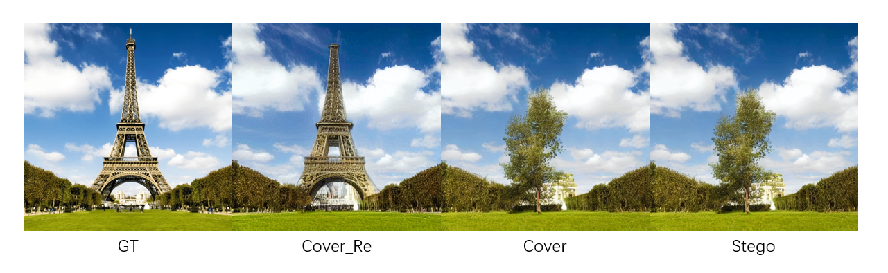

# 周报 - 2026.10.19 - 2026.10.25
---
# 一、本周核心工作/学习内容

## 文献阅读

- 【论文】（噪声、VAE、扩散模型抹除水印思路） —— [*Invisible Image Watermarks Are Provably Removable Using Generative AI*](../../papers/week11/paper1.md)
- 【论文】（CtrlRegen从噪声开始生成去水印图片） —— [*IMAGE WATERMARKS ARE REMOVABLE USING CONTROLLABLE REGENERATION FROM CLEAN NOISE*](../../papers/week11/paper2.md)

## 论文方法复现

使用 `stable-diffusion-v1-5` 模型复现 paper1 中采用扩散模型的去水印过程，论文的整体思路就是对图片进行不完全的加噪，在 LDM 中就是不完全加噪成纯噪声，保留原图大部分信息，通过加噪和去噪过程产生的“失真”达到去除水印的效果。

如图所示，GT 是原始图片，Stego 是 CRoSS 得到的隐写图，Cover 是经过去水印处理的图片，可以看到和 Stego 基本没有差别，Cover_Re 是 Cover 通过 CRoSS 逆过程得到的还原图，可以看见失真了很多，但是还是能多少提取出秘密。毕竟这种方法的主要目的是通过扰动去除小型水印，扩散模型的生成隐写的抗干扰性还是比较强的。

# 二、问题与解决

# 三、下周计划

- [ ] 复现第二篇论文的方法，拿 CRoSS 生成的 stego 测试。
- [ ] 更深入学习扩散模型，

# 四、总结

确定今后的日常努力方向，多读论文，不会的尽快学。已经在仓库中创建了 `papers` 目录存放读的论文，后续论文内容都存放在内。