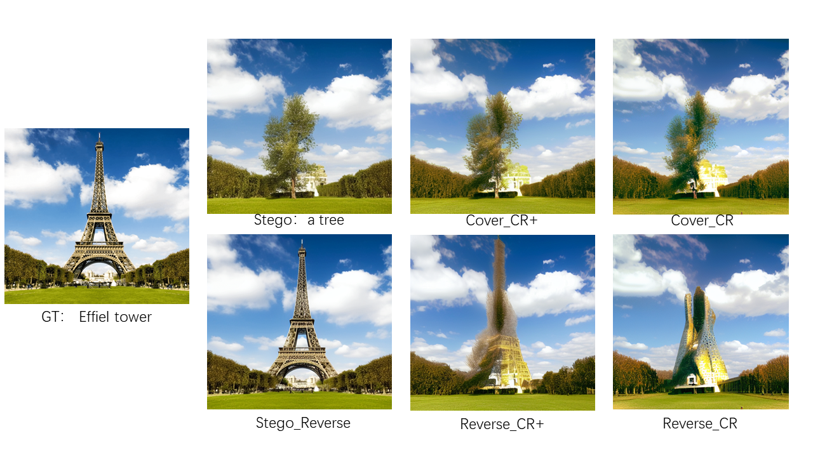

# 周报 - 2026.10.26 - 2026.11.1
---
# 一、本周核心工作/学习内容

## 基础知识

### IDDPM

#### 一、加噪的改进

_核心改进：Beta 表（噪声调度）线性调度 → 余弦调度_

IDDPM 将 DDPM 的**线性 beta 调度**替换为**余弦调度**。目的是让前向加噪过程更平缓，避免图像在扩散后期过早变成纯噪声，从而保留更多有效信息供模型学习。

**线性调度的问题**：原始 DDPM 使用线性增长的 `β_t`。这会导致在扩散过程的后期，图像加噪速度过快，很多步骤中的图像已经接近纯噪声，对训练和似然优化贡献很小，造成了步骤浪费。

**余弦调度的公式**：IDDPM 改为直接定义**累积噪声系数 `ᾱ_t`** 遵循余弦函数，再反推出每一步的 `β_t`：

\[
\bar{\alpha}_t = \frac{f(t)}{f(0)}, \quad f(t) = \cos^2\left(\frac{t/T + s}{1 + s} \cdot \frac{\pi}{2}\right)
\]

其中 `s` 是一个很小的偏置参数（通常取 **0.008**），用来防止 `t` 接近 0 时分母过小导致数值不稳定。得到 `ᾱ_t` 后，`β_t` 由相邻两步的比值算出：

\[
\beta_t = 1 - \frac{\bar{\alpha}_t}{\bar{\alpha}_{t-1}}
\]

**这样改的好处**：相比线性调度，余弦调度在扩散的**中间阶段加噪更缓慢**，在接近纯噪声的后期也不会过于突兀。这使得每一段扩散步骤都能更均匀地破坏数据信息，模型能在更多步骤中学到有意义的去噪信号，最终在似然指标和生成质量上都获得提升。

IDDPM 中余弦 beta 表的代码实现，核心在于 `betas_for_alpha_bar` 这个辅助函数。它并没有直接逐项计算 `β_t`，而是先定义累积系数 `ᾱ_t` 的函数，再通过相邻时间步的比值反推 `β_t`。

这是 OpenAI 官方实现中生成余弦调度的基础：

```python
def betas_for_alpha_bar(num_diffusion_timesteps, alpha_bar, max_beta=0.999):
    betas = []
    for i in range(num_diffusion_timesteps):
        t1 = i / num_diffusion_timesteps
        t2 = (i + 1) / num_diffusion_timesteps
        betas.append(min(1 - alpha_bar(t2) / alpha_bar(t1), max_beta))
    return np.array(betas)
```

**关键细节**：
- `alpha_bar` 是一个接受 `t ∈ [0,1]` 并返回 `ᾱ_t` 的 lambda 函数。
- 每一步的 `β` 由 `1 - ᾱ_{t+1} / ᾱ_t` 算出，这正是上一轮公式的离散化实现。
- `max_beta=0.999` 是一个硬性截断，防止 `β` 接近 1 导致数值奇异。但社区中有讨论指出，在余弦调度下这个截断值可能过大，实际训练时若遇到采样方差爆炸，可考虑调低。

在 `get_named_beta_schedule` 中，余弦分支直接传入对应的 lambda：

```python
elif schedule_name == "cosine":
    return betas_for_alpha_bar(
        num_diffusion_timesteps,
        lambda t: math.cos((t + 0.008) / 1.008 * math.pi / 2) ** 2,
    )
```

这里的 `0.008` 就是上一轮提到的偏置 `s`。注意 lambda 内部已经包含了 `(t + s) / (1 + s)` 的完整形式，因此 `alpha_bar(t)` 返回的已经是归一化后的 `ᾱ_t`。

**拿到 betas 之后** `GaussianDiffusion` 的 `__init__` 接收到这个 `betas` 数组后，会立即用 `np.cumprod` 重新计算出 `alphas_cumprod`，供后续前向加噪和反向采样使用：

```python
alphas = 1.0 - betas
self.alphas_cumprod = np.cumprod(alphas, axis=0)
```

也就是说，代码中 `betas` 是“源数据”，所有需要的 `ᾱ_t`、`√ᾱ_t`、`√(1-ᾱ_t)` 等系数都是从它派生出来的。

#### 二、提升对数似然（Log-likelihood）的拟合

在原始 DDPM 中，模型虽然在视觉生成质量（如 FID 指标）上表现惊人，但在 **对数似然（Log-likelihood）** 指标上却表现较差（即模型在数学上对真实数据分布的拟合不够精确）。导致这一问题的核心原因有两个：

- **方差被固定**：DDPM 将反向过程的方差 \(\Sigma_\theta(x_t,t)\) 设定为固定的常数（如 \(\beta_t\) 或 \(\tilde{\beta}_t\)），没有让网络去学习。这导致变分下界（VLB）中与方差相关的项无法被优化，限制了似然表现的上限。
- **目标函数被简化**：DDPM 放弃了完整的 VLB，使用了去掉权重系数的简化损失 \(L_{\text{simple}}\)（预测噪声的 MSE）。这虽然有助于生成高质量图像，但牺牲了严格的概率建模能力，导致对数似然较差。

##### 改进方法
为了让模型不仅能生成逼真图像，还能在数学上更好地拟合真实数据分布，IDDPM 从损失函数和方差设定两方面进行了重新设计：

- **设计一：引入可学习的方差（Learned Variance）**
  - 让神经网络在预测均值（噪声）的同时，额外输出反向过程的方差。
  - **重参数化技巧**：为了保证训练稳定，网络不直接预测方差数值，而是输出一个系数 \(v\)，在固定的前向方差 \(\beta_t\) 和后验方差 \(\tilde{\beta}_t\) 之间做**对数域的凸组合**：
\[
 \Sigma_\theta(x_t, t) = \exp\left(v \log \beta_t + (1-v) \log \tilde{\beta}_t\right) 
\]
    - 这种方式补全了理论推导的拼图，让 VLB 中的方差项真正参与梯度下降。

```python
# 模型输出拆分（逻辑示意）
model_output, model_var_values = th.split(model_output, x.shape[1], dim=1)

# 将方差预测值映射到 [0, 1]
frac = (model_var_values + 1) / 2

# 对数域凸组合：在 min_log 与 max_log 之间插值
model_log_variance = frac * max_log + (1 - frac) * min_log
model_variance = th.exp(model_log_variance)
```

- **设计二：混合训练目标（Hybrid Objective）**
  - 为了兼顾 \(L_{\text{simple}}\) 稳定的梯度信号和完整 VLB 对似然的严格优化，论文提出了混合损失函数：
        \[
 L_{\text{hybrid}} = L_{\text{simple}} + \lambda L_{\text{VLB}} 
\]
    - 其中 \(\lambda\) 是一个较小的权重（论文中取 \(0.001\)），\(L_{\text{VLB}}\) 是完整的变分下界。\(L_{\text{simple}}\) 负责稳定训练并保证视觉质量，\(L_{\text{VLB}}\) 负责提供方差学习的梯度信号并提升对数似然。

```python
# L_simple: 预测噪声的 MSE
simple_loss = mean_flat((noise - pred_noise) ** 2)

# L_VLB: 真实后验与预测分布之间的 KL
kl = normal_kl(true_mean, true_log_variance_clipped, 
               model_mean.detach(), model_log_variance)  # detach 稳定梯度
kl = mean_flat(kl) / np.log(2.0)  # 转换为 bits per dimension

# 混合损失，lambda 默认为 0.001
vb_loss_weight = 0.001
total_loss = simple_loss + kl * vb_loss_weight
```

- **附加优化：重要性采样（Importance Sampling）**
  - 由于 VLB 项在不同时间步 \(t\) 的梯度噪声差异很大，论文引入了一种简单的重采样策略，让模型在训练时更多地关注梯度噪声较大的时间步，进一步降低梯度方差，提升似然表现。

#### 三、减少梯度噪声

IDDPM 在减少梯度噪声方面，核心手段是**重要性采样（Importance Sampling）**，具体在代码中被称为 **`loss-second-moment` 采样器**。

完整的 VLB（变分下界）虽然能提升对数似然，但它在不同时间步 \(t\) 上的梯度方差差异很大。如果训练时对 \(t\) 进行均匀采样，那些梯度噪声大的时间步会主导训练，导致优化不稳定。IDDPM 的解决办法是：**不再均匀地随机抽取 \(t\)，而是根据每个时间步的损失大小来调整采样概率**，让“难学”的步被更频繁地抽到，从而降低整体梯度的方差。

##### 核心类：`LossSecondMomentResampler`

这个类继承自 `LossAwareSampler`，初始化时维护一个 `[T, history_per_term]` 的损失历史数组，以及每个时间步已记录次数的计数器。

```python
class LossSecondMomentResampler(LossAwareSampler):
    def __init__(self, diffusion, history_per_term=10, uniform_prob=0.001):
        self.diffusion = diffusion
        self.history_per_term = history_per_term
        self.uniform_prob = uniform_prob
        self._loss_history = np.zeros(
            [diffusion.num_timesteps, history_per_term], dtype=np.float64
        )
        self._loss_counts = np.zeros([diffusion.num_timesteps], dtype=np.int)
```

##### 权重计算：`weights()`

这是决定“每个时间步被抽中概率”的核心函数。逻辑分两步：

**第一步：预热阶段。** 如果任何时间步的损失记录还没攒够 `history_per_term` 条，直接返回全 1 权重，退化为均匀采样。这防止早期统计不准时引入偏差。

**第二步：正式计算。** 对每个时间步 \(t\)，取它最近若干次损失的**均方根**（即二阶矩的平方根），作为该步的“难度分数”。难度越高，被抽中的概率越大。

```python
def weights(self):
    if not self._warmed_up():
        return np.ones([self.diffusion.num_timesteps], dtype=np.float64)
    
    weights = np.sqrt(np.mean(self._loss_history ** 2, axis=-1))    # 每个时间步的难度分数
    weights /= np.sum(weights)  # 分数归一化
    weights *= 1 - self.uniform_prob
    weights += self.uniform_prob / len(weights)
    return weights
```

`uniform_prob=0.001` 是一个很小的保底概率，确保所有时间步都有极低概率被抽到，防止某些步因为长期未被采样而“饿死”。

##### 损失更新：`update_with_all_losses()`

每次训练迭代后，把当前 batch 中每个样本对应的时间步 \(t\) 和它的损失值写回历史。如果某个 \(t\) 已经攒满 `history_per_term` 条记录，就**先进先出**，挤掉最旧的一条，放入最新损失。

```python
def update_with_all_losses(self, ts, losses):
    for t, loss in zip(ts, losses):
        if self._loss_counts[t] == self.history_per_term:
            self._loss_history[t, :-1] = self._loss_history[t, 1:]
            self._loss_history[t, -1] = loss
        else:
            self._loss_history[t, self._loss_counts[t]] = loss
            self._loss_counts[t] += 1
```

##### 采样与无偏修正：`sample()`

`LossSecondMomentResampler` 本身不实现 `sample()`，它继承自父类 `ScheduleSampler`。父类的 `sample` 方法做了两件事：

1. **按权重采样**：用 `np.random.choice` 根据 `weights()` 算出的概率 \(p\) 抽取时间步。
2. **施加重要性权重**：返回一个 `weights` 张量，值为 \(\frac{1}{T \cdot p[\text{index}]}\)。这个权重在后续计算损失时会乘到对应样本的 loss 上，**抵消因为采样概率改变而引入的偏差**，保证梯度的期望仍然是无偏的。

```python
def sample(self, batch_size, device):
    w = self.weights()
    p = w / np.sum(w)
    indices_np = np.random.choice(len(p), size=(batch_size,), p=p)
    indices = th.from_numpy(indices_np).long().to(device)
    weights_np = 1 / (len(p) * p[indices_np])
    weights = th.from_numpy(weights_np).float().to(device)
    return indices, weights
```

##### 在训练循环中怎么用

训练脚本里，每个 batch 拿到 `(ts, weights)` 后，计算出的 loss 会先乘上 `weights`，再进行反向传播。同时，在优化器更新前，调用 `update_with_local_losses` 把当前 loss 写回采样器，供下一轮权重计算使用。

一句话概括代码链路：**记录每步历史损失 → 用二阶矩算采样概率 → 按概率抽 \(t\) 并算重要性权重 → 损失乘以权重保持无偏 → 更新历史供下一轮使用**。

##### 与混合损失的关系

这个重要性采样主要服务于 **VLB 项**（即 `--use_kl True` 时）。论文发现，直接优化 VLB 的梯度噪声太大，所以先引入混合损失（MSE + λ·VLB）稳住训练，再用重要性采样专门降低 VLB 部分的方差。官方 README 也明确将“Importance-sampled VLB”作为一项改进列出，需要同时开启 `--use_kl` 和 `--schedule_sampler loss-second-moment`。

一句话总结：IDDPM 通过 `loss-second-moment` 采样器，让模型在训练时更关注那些损失大、梯度噪声高的时间步，从而在引入 VLB 优化对数似然的同时，保持训练的稳定性。

## 实验部分

### 复现 CtrlRegen

这周复现 IMAGE WATERMARKS ARE REMOVABLE USING CONTROLLABLE REGENERATION FROM CLEAN NOISE 这篇论文的代码，测试对 CRoSS 隐写进行攻击的效果，结果如下：



其中CtrlRegen+使用的step为1.0。

# 二、问题与解决

1. **问题1**：Adam 等优化器和重要性采样有什么区别？

    - 回顾之前学习的优化算法，重要性采样与 Adam 等优化器都是让梯度变化更平缓，优化器防止采样的任何样本导致的梯度变化太快，同时控制学习率，而重要性采样直接从采样方法上利用规律动手。

    这两者的本质区别在于：

    1. **Adam 处理的是“结果（梯度）”，重要性采样处理的是“原因（数据分布）”**
       * 均匀抽样时，模型每天抽到的题目难度相差 10 万倍（\(t=10\) 和 \(t=900\)）。Adam 强行把这些难度差异巨大的梯度平滑在一起，这其实是**扭曲了真实的优化地形**，导致模型最终偏离了严格的数学目标（对数似然差）。
       * 重要性采样直接从源头改变了题目分布，让每天抽到的题目难度差不多。Adam 看到的不再是悬崖峭壁，而是缓坡，它就不需要再强行扭曲梯度了。

    2. **Adam 是被动防御，重要性采样是主动进攻**
       * 如果模型一直在 \(t=900\) 这种极端的步上产生巨大梯度，Adam 只能不停地压缩、修正。但如果你不去主动多训练这些困难的步，模型永远学不会。
       * 重要性采样不仅平滑了梯度，还**把算力（计算资源）集中在了那些真正能提升模型能力的“困难样本”上**（即 Loss 大的时间步），这是一种主动的“难例挖掘”。

# 三、下周计划

- [x] 学习 CFG、LDM 和其他前置知识。

# 四、总结

其实从代码中，我们总能发现自己知识体系的不足，找到学习的方向。