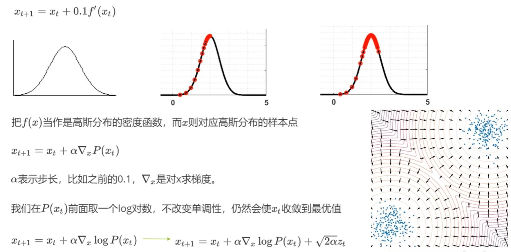
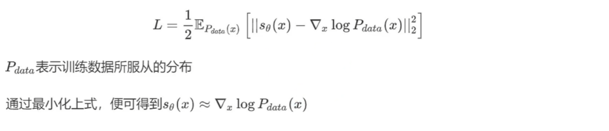
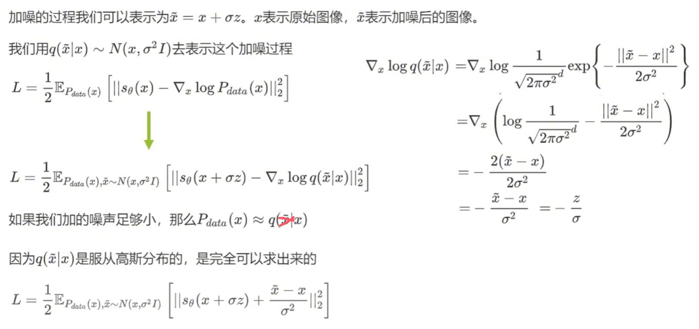
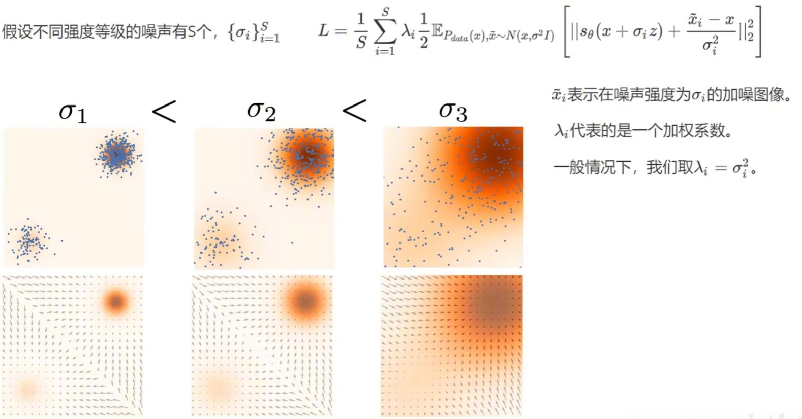
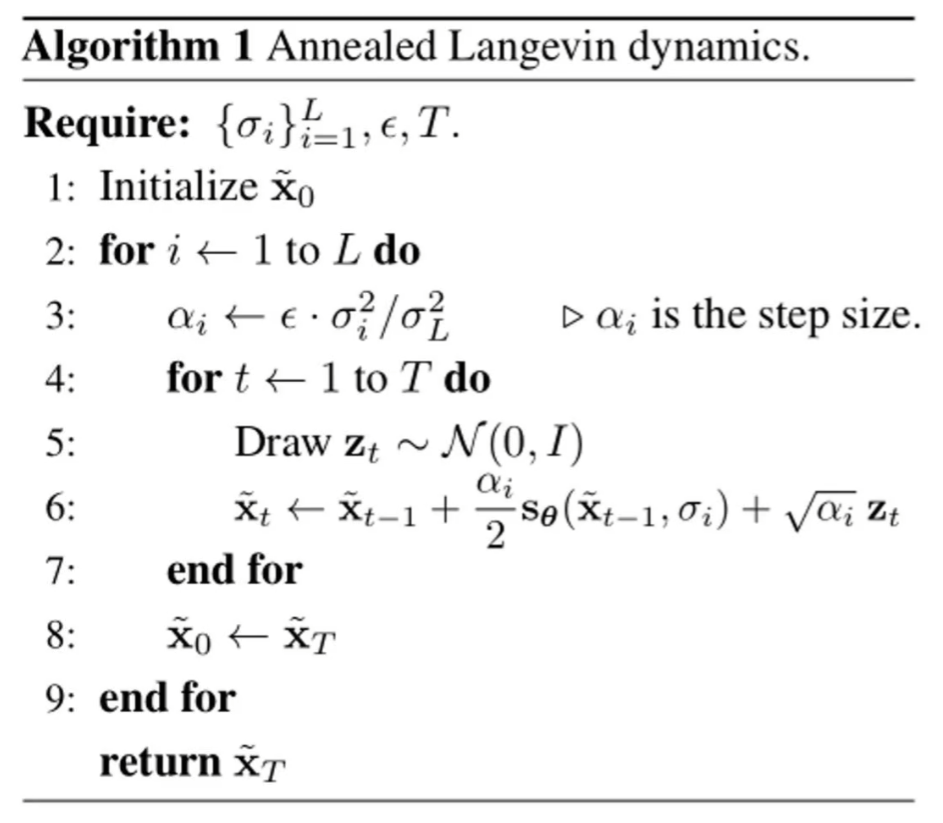
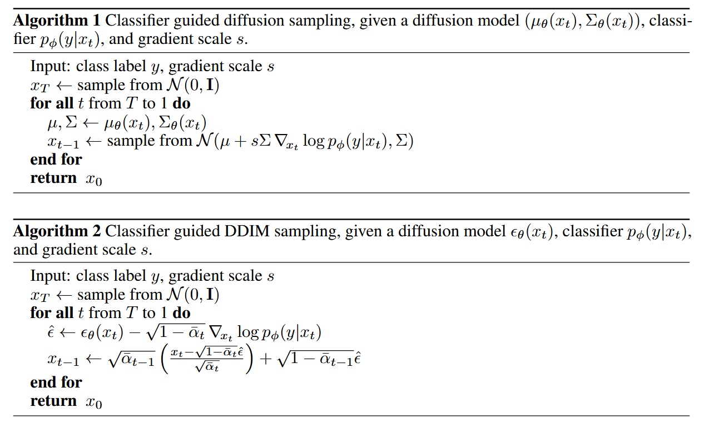

# 周报 - 2026.11.02 - 2026.11.08
---
# 一、本周核心工作/学习内容

## 基础知识

### 1.NCSN（Noise Conditional Score Network）

_参考[NCSN：估计数据分布的梯度进行生成建模](https://www.bilibili.com/video/BV1hFskzSE6f/?share_source=copy_web&vd_source=dcedb729c1920a524ddace9deca746fd)_

NCSN，和扩散模型关系很深，可以理解为 DDPM 之前、从“分数匹配”这条路径发展出来的生成模型。它的核心思想是：不直接学数据分布，而是学数据分布的对数概率密度对输入的梯度（即“分数”），再用朗之万动力学采样生成样本。

首先，我们都知道梯度上升的原理，从梯度上升我们可以过渡到泛化性更好的表达，如图所示：

利用这个等式去生成图片，现在的问题是$P(x_t)$的梯度我们求不出来，不过可以通过训练逼近，根据下面的loss训练得到$s(x)$。

不过依赖模型训练也会有问题，因为样本服从分布复杂，概率分布会出现一些低密度区域，那么对应的样本就少，意味着对应的梯度分数得不到很好的训练，那么神经网络在那些样本点就很容易估不准。

论文就提出加噪声的方法解决这个问题，让整个分布的密度更加均匀。

这里需要设计加噪噪声的大小，噪声越大低密度区就越少。我们可以使用不同梯度的噪声强度分别训练三个网络（当然不可能），论文设计一个 L 得到不同噪声下的得分。

后续采样就可以先通过大噪声梯度上升，逐步减小噪声。

    

### 2. Classifier Guidance

_参考《Diffusion Models Beat GANs on Image Synthesis》论文_

一句话定位：在**带噪图像**上训练一个噪声感知分类器 `p_φ(y|x_t, t)`，用其对数概率对 `x_t` 的**梯度**修正每一步反向采样，把生成过程"推"向目标类别 `y`。

#### 2.1 动机与核心思想

- **来自 GAN 的启示**：GAN 的条件图像生成大量使用类别标签（类别条件归一化统计、判别器上类似分类器 `p(y|x)` 的分类头），类别信息是条件生成质量的关键。论文第 3 章已把类别信息注入归一化层（AdaGN），第 4 章探索另一条路线——**用一个分类器来引导扩散生成器**：训练 `p_φ(y|x_t, t)`，用梯度 `∇_{x_t} log p_φ(y|x_t)` 把采样过程引向任意指定类别。
- **为什么分类器必须在带噪图像上训练**：采样发生在从 `x_T` 到 `x_0` 的**所有噪声水平**上，在干净图像上训练的普通分类器面对高噪声 `x_t` 时毫无判别力。因此分类器要在**与扩散模型相同的加噪分布**上训练，且以时间步 `t` 为条件输入（每个 `t` 对应一个分类器）。论文实现直接用 UNet 的下采样主干 + 8×8 分辨率处的 attention pool 产生分类输出，并加随机裁剪防过拟合。
- **修正我原先的理解**：起作用的不是分类器的"预测概率"本身，而是**对数概率的梯度（得分）**——它指出"往哪个方向修改 `x_t` 能让它更像是类别 `y`"；正是这个梯度平移了每步采样的高斯分布均值。

#### 2.2 条件反向去噪过程的推导

出发点是贝叶斯：把无条件反向转移核 `p_θ(x_t|x_{t+1}) = N(μ, Σ)` 变成条件版本：

\[
p_{\theta,\phi}(x_t \mid x_{t+1}, y) = Z \, p_\theta(x_t \mid x_{t+1}) \, p_\phi(y \mid x_t)
\]

精确采样这个分布不可行，论文沿用 Sohl-Dickstein 等人的近似推导：

1. **泰勒展开**：假设 `log p_φ(y|x_t)` 相对 `Σ⁻¹` 曲率较小（扩散步数趋于无穷、`||Σ|| → 0` 时合理），在 `x_t = μ` 处做一阶泰勒展开：`log p_φ(y|x_t) ≈ (x_t − μ)ᵀg + C`，其中 `g = ∇_{x_t} log p_φ(y|x_t)|_{x_t=μ}`；
2. **配方**：将这个线性项代回高斯指数部分，配出 `(x_t − μ − Σg)ᵀΣ⁻¹(x_t − μ − Σg)` 的二次型，常数项全部并入归一化系数 `Z`，得到

\[
p_{\theta,\phi}(x_t \mid x_{t+1}, y) \approx \mathcal{N}(\mu + \Sigma g, \; \Sigma)
\]

**关键结论**：在近似下，条件化**只平移均值、方差不变**——均值被平移 `Σg`。两点值得注意：

- 起作用的是**梯度 `g`**（指向"更像类别 `y`"的方向），不是概率值本身；
- 平移量带**协方差 `Σ`** 作系数：当前步不确定性大（`Σ` 大）的方向推得多、确定性高的方向推得少，相当于一种自适应步长。

对应上图 **Algorithm 1**：每步采样 `x_{t-1} ~ N(μ + s·Σ·∇_{x_t} log p_φ(y|x_t), Σ)`，其中 `s` 为梯度尺度（见下文四）。另外论文脚注指出：严格来说 `x_T` 也应以 `y` 为条件采样，但当加噪过程足够强时，`x_T` 即使在条件情况下也近似纯高斯，直接从 `N(0, I)` 采样即可。

#### 2.3 DDIM 的条件采样

4.1 的推导依赖**随机**高斯转移核，无法直接套用到 DDIM 这类**确定性**采样器。论文改用 score 视角，利用扩散模型与得分匹配的联系：

\[
\nabla_{x_t} \log p_\theta(x_t) = -\frac{1}{\sqrt{1-\bar{\alpha}_t}} \epsilon_\theta(x_t)
\]

由 `∇ log(p_θ(x_t)·p_φ(y|x_t)) = 无条件得分 + 分类器得分`，可定义修正后的噪声预测：

\[
\hat{\epsilon}(x_t) := \epsilon_\theta(x_t) - \sqrt{1-\bar{\alpha}_t} \, \nabla_{x_t} \log p_\phi(y \mid x_t)
\]

之后直接套用标准 DDIM 更新公式即可（对应上图 **Algorithm 2**）。**统一理解**：两种算法本质相同——条件得分 = 无条件得分 + 分类器得分；DDPM 版体现在**均值参数化**上（平移均值），DDIM 版体现在 **ε 参数化**上（修正噪声预测）。

#### 2.4 梯度尺度 s：保真度—多样性的权衡

**为什么需要 `s > 1`**：`s = 1` 时分类器虽给目标类约 50% 的概率，但样本目视并不像该类；放大梯度后类别概率升至接近 100%，类别一致性显著提升（论文 Figure 3 的 corgi 示例：`s=1.0` FID 33.0 → `s=10.0` FID 12.0）。

**理论解释**：

\[
s \cdot \nabla_x \log p(y \mid x) = \nabla_x \log \frac{1}{Z} p(y \mid x)^s
\]

即尺度 `s` 等价于把引导分布换成**重归一化的更尖分布 `p(y|x)^s`**：`s > 1` 时指数放大大概率模式，引导更聚焦于分类器的众数 → **保真度更高、多样性更低**。

**实验结论**（Table 4 / Figure 4 / Figure 5）：

- 引导对**无条件 `p(x)` 与条件 `p(x|y)`** 扩散模型都适用；高尺度下，被引导的无条件模型能逼近未引导条件模型的 FID，但直接用标签训练的条件模型仍更好，条件模型再叠加引导 FID 最优；
- 引导提升 **precision / IS（保真）**、牺牲 **recall（多样性）**；FID 与 sFID 兼顾两者，最优值出现在**中间尺度**；
- 与 BigGAN 的 truncation trick 对比：FID–IS 权衡上**严格更优**；precision–recall 权衡只在一定 precision 阈值内占优，超过后分类器引导无法达到 BigGAN 的极高 precision。

## 论文阅读（AIGC 检测前沿）

本周梳理 CSIG《AI 时代下的视频内容安全防御》沙龙的四篇论文（浙大三篇 + 中科院自动化所一篇）。

**领域背景**：AIGC 检测的任务是判断一段图像/视频是"真实拍摄"还是"AI 生成"（含全自动生成与局部编辑）。核心难点在于生成器迭代太快（GAN → 扩散 → Flow Matching/DiT），每一代模型留在成品里的伪影"指纹"都不同——今天学到的伪影特征明天就可能失效，因此**跨生成器泛化**（对没见过的生成模型依然有效）是领域最核心的指标，理想检测器还要求抗后处理（压缩/模糊/缩放）与可解释。当前研究分两大流派：**外观/认知流派**在成品中找伪影或语义破绽，靠推理架构换取泛化（REVEAL、ClueAegis）；**过程/规律流派**绕开成品外观，探测生成过程动力学或物理规律（TRACE、MotionPhys）。

### 1. REVEAL：推理增强的可解释图像检测

一句话定位：把检测从黑盒二分类改造成"先摆证据、再下结论"的可审计取证推理。

**Benchmark（REVEAL-Bench）**：三阶段流水线造数据——
1. 数据筛选：汇总 6 个现有检测基准约 600 万图，按美学分/分辨率/语义类分层抽样；
2. 专家取证：8 个轻量专家模型（现成开源、零训练）各管一类底层信号——局部伪影、频谱、像素噪声、空间一致性、几何缺陷、阴影逻辑、纹理融合、高通融合，输出伪影掩码 + 诊断标签；
3. CoE 合成：Qwen2.5-VL-72B 将 8 份零散证据整合成一条渐进式证据链（格式 `<think>…</think><answer>…</answer>`），600 万样本严格筛到 6 万（真假各 3 万，约 1% 留存率）。

**Method（两阶段训练）**：
- Stage 1 CoE Tuning（SFT 冷启动）：概率分解 p(y,z|x) = p(z|x)·p(y|x,z)，先推理后下结论，从结构上杜绝 post-hoc 合理化；损失 = 推理损失 + 答案损失（权重 α=0.1，答案为主）+ KL 防遗忘项；
- Stage 2 R-GRPO（强化学习）：在 GRPO 上设计三重奖励——答案对错（0.8）、推理质量（0.1，将推理步骤打乱后若结论剧变则扣分，逼推理真正"承重"）、多视角证据对齐（0.1，think 内容需与频谱图/高通图等证据视图一致）；由 Qwen3-VL-8B 充当裁判 Agent 打分；
- 关键设计：8 个专家只用于离线造数据，训练与推理时全部退场。

### 2. ClueAegis：启发式到推理的认知技能学习（REVEAL 同团队续作）

一句话定位：用认知科学"快/慢思维"（System 1/2）把检测改造成"先选工具、再细查"的智能体范式。动机：光照、频谱、OCR、解剖等取证线索分布异质，一锅炖推理会导致特征纠缠 → 需要显式路由。

**Benchmark（ClueAegis-Bench）**：120K 图，标签不是真/假，而是"12 个取证技能中哪个最能抓住它"（光照/阴影/物理/常识/功能矛盾/OCR/人体/区域/动物解剖/频率/像素/变换一致性），每技能约 5K 真 + 5K 假；由 Qwen3-VL-235B 当"自动取证员"逐技能试标。

简单来说，benchmark 的每个标签代表的是论文设计的12个 skill/tools 中选用的哪一个。像 REVEL 那篇文章是用 benchmark 训练一个模型，让一个模型提供八种取证信息，所有取证信息合作为依据。而这篇文章认为选择一种取证信息作为依据可以有更好的效果，则设计12种取证方法，让模型选择最好的方法取证。

**Method（两阶段智能体推理 + 三步训练）**：
- System 1 启发式选路：感知编码器提取取证线索 c = f(x)，LLM 从技能库中匹配最相关技能 s* = Select(c, K)；
- System 2 技能条件化推理：把选中技能转成专属取证提示词做推理 R = P(x, s*)，过程中可现场调用外部工具（如 PaddleOCR）获取辅助证据 o，融合后输出真伪 y = Φ(R, o)；
- 形式化对比：旧方法 p(y|x, E)（纠缠证据联合推理）→ 本方法 p(y|x, e*)（选路后聚焦单路证据）；
- 训练：Stage I SFT 学选技能 → Stage II SFT 学技能条件下判真伪 → GRPO 对齐（奖励 = 答案对错 + 技能选择一致 + 格式合规）。

### 3. TRACE：基于生成动力学的视频检测

一句话定位：不看视频"长什么样"，把预训练视频 DiT 当"速度场探针"，从生成过程层面找指纹。

核心观察：真视频与 AI 视频在预训练 Flow Matching 模型下的**速度响应**不同（真视频响应整体更小），且更换探针骨干结论仍成立 → 信号来自生成动力学本身，可跨生成器迁移。

**Method（三模块）**：
1. 生成轨迹表征：将视频 N 帧加噪到 K=5 个低噪声探测点（{0, 25, 50, 75, 100}，1000 级调度器），逐个喂给冻结的 Wan2.2-A14B DiT，读取各噪声水平下的速度响应，堆成 K×N×D 张量（注意"轨迹"指生成流噪声轴，不是视频播放时间轴）；
2. 轨迹一致性估计：同一噪声水平、同一噪声实现下对相邻帧速度响应做差 Δv——真视频相邻帧平滑演化 → 响应变化规律，AI 视频时序不一致 → 响应跳变；与原始响应融合成最终特征；
3. RCTO 真视频中心轨迹优化：用 EMA（α=0.99）维护真视频特征中心 μ，真视频特征向 μ 收拢（pull），AI 视频推离 μ 超过间隔 m（push，softplus 边际，推够即停）；让模型学"离真实分布偏离多远"，而非记忆特定生成器的伪影；
- 训练只更新最后的分类头，DiT/VAE/文本编码器全部冻结。

### 4. MotionPhys：基于光流轨迹物理一致性的视频检测

一句话定位：从物理规律找破绽——AI 视频相邻帧看似平滑，但无法在整个动作过程中保持运动协调（平衡调整、摆腿、球离脚后的运动），而物理规律不随生成器升级而改变。

**Method（轨迹提取 → 差分运动表征 → 多尺度统计聚合 → 轻量分类）**：
1. 轨迹提取（打运动点）：均匀采样 48 帧；追踪点由 Shi-Tomasi 角点（纹理区观测可靠）+ 规则网格点（平滑区保证覆盖）两部分构成，用金字塔 Lucas-Kanade 光流逐帧跟踪，把成功跟踪的位置连成图像平面上的 2D 运动轨迹；在 8/12/24 帧三个时间尺度上分别提取——短轨迹对瞬态局部异常敏感，长轨迹刻画持续的动作演化；
2. 差分运动表征：对每条轨迹做一阶差分得速度、二阶差分得加速度，在此基础上算三个互补的物理量——**曲率** κ（轨迹局部弯曲程度；自然运动受物理约束弯曲平缓，生成视频出现过平滑段或局部突变）、**角速度** ω（相邻步运动方向夹角，捕捉转弯行为的异常）、**急动度** jerk ρ（加速度的差分，三阶量，对帧间运动的突然变化敏感）；
3. 多尺度统计聚合：轨迹级——每个物理量序列用 8 种统计量（均值/标准差/最值/偏度/峰度/中位数/IQR）汇总为 24 维描述子；尺度级——对该尺度下所有轨迹的每个维度再取 7 种统计量得 168 维；三个尺度拼接成 504 维视频级物理一致性表示（跨轨迹、跨尺度的鲁棒聚合可抑制个别跟踪误差）；
4. 分类决策：LightGBM 轻量分类器——判别信息已显式编码在物理特征中，无需复杂视频骨干网络；且特征物理含义明确，检测结果可回溯到"轨迹几何异常 / 转弯动态异常 / 高阶平滑度异常"，可解释性强。

# 二、问题与解决

# 三、下周计划

- [ ] 继续学习扩散模型基础知识，同步进行研究方向的实验。

# 四、总结

其实从代码中，我们总能发现自己知识体系的不足，找到学习的方向。
