# 周报 - 2026.09.04 - 2026.09.11
---
# 一、本周核心工作/学习内容

知识来源于：[【教程】零基础入门PCB设计-国一学长带你学嘉立创EDA专业版](https://www.bilibili.com/video/BV1At421h7Ui/?share_source=copy_web&vd_source=dcedb729c1920a524ddace9deca746fd)

## 基本元件

### 1. 电阻元件

电阻器（Resistor）在日常生活中一般直接称为电阻。是一个限流元件，将电阻接在电路中后，电阻器的阻值是固定的一般是两个引脚，它可限制通过它所连支路的电流大小。阻值不能改变的称为固定电阻器。阻值可变的称为电位器或可变电阻器。
端电压与电流有确定函数关系，体现电能转化为其他形式能力的二端器件，用字母R来表示，单位为欧姆Ω。实际器件如灯泡，电热丝，电阻器等均可表示为电阻器元件。

$$
R = \frac{U}{I}
$$

- **插接式电阻读法**：
  - 四线段电阻：下图上方电阻，前两段作为数值读数，图中为 `23（红橙）`，第三段为乘数，最后一段是误差，结果是 `23x1±5%Ω`。
  - 五线段电阻：下图中下方的电阻，前三段为读数，第四段为乘数，最后一段为误差，结果为 `470x0.1±1%Ω`

    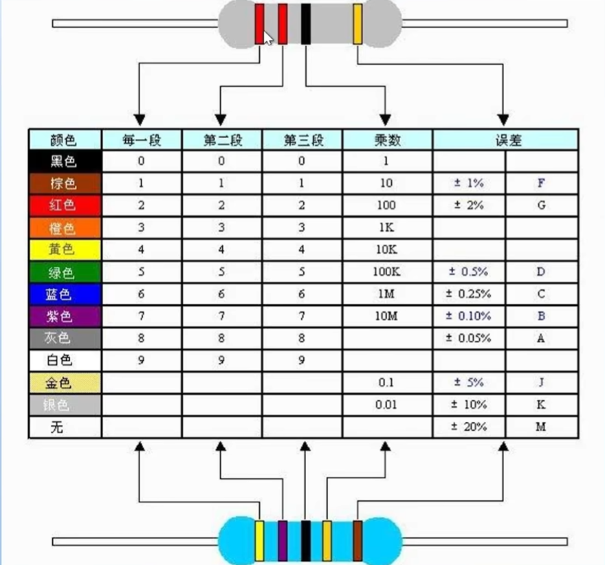

- **贴片式电阻读法**：
  - 3位读数：前己位为有效数字，第3位表示10的n次幂（也可以理解为0的个数）。精度为±5%
  - 4位读数：前3位为有效数字，第4位表示10的n次幂（也可以理解为0的个数）。读法和3位的原理一样，精度为±1%
  - 阻值小于10的读数：通常在两个数之间插入一个字母R，用字母R来代替小数点。

    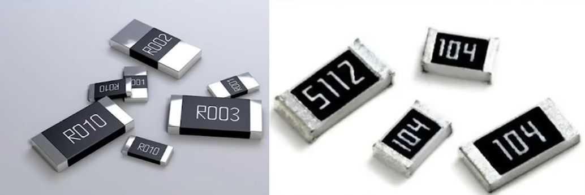

### 2. 电容元件

- 电容：又叫电容器，是指容纳电荷本领的物理量。电容一般用通常用“C”表示（Capacitance）
- 电容的单位是法拉，简称法，符号是F，常用的电容单位有毫法（mF）、微法（μF）、纳法（nF）和皮法（pF）等，单位为干进行换算，如1uF=1000nF;1nF=1000pF。各种电容通常会标注三种信息：正负极、标称容量和耐压。

$$
C = \frac{Q}{U}
$$

实际的电子产品应用中，根据电容“通交流，隔直流”的特性，在电路中所起的作用主要是储能与滤波。

    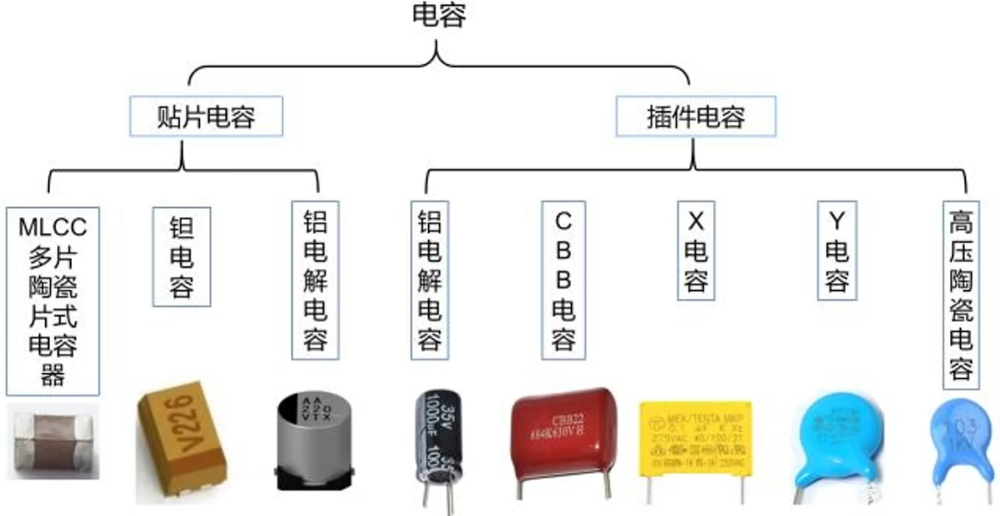

### 3. 电感元件

- 电感是能够把电能转化为磁能存储起来的元件。
电感（Inductor）：通常用字母“L”表示。电感的单位是亨利，简称亨，符号是H，常用的电感单位有亨（H）、毫亨（mH）、微法（μH），换算关系是：1H=1000mH;1mH=1000uH;

$$
e_L = -L \frac{di}{dt}
$$

- 实际的电子产品应用中，根据电感“通直流，隔交流”的特性，在电路中所起的作用主要是滤波，扼流，谐振，储能。
- 电感元件的读法和电阻一致。

    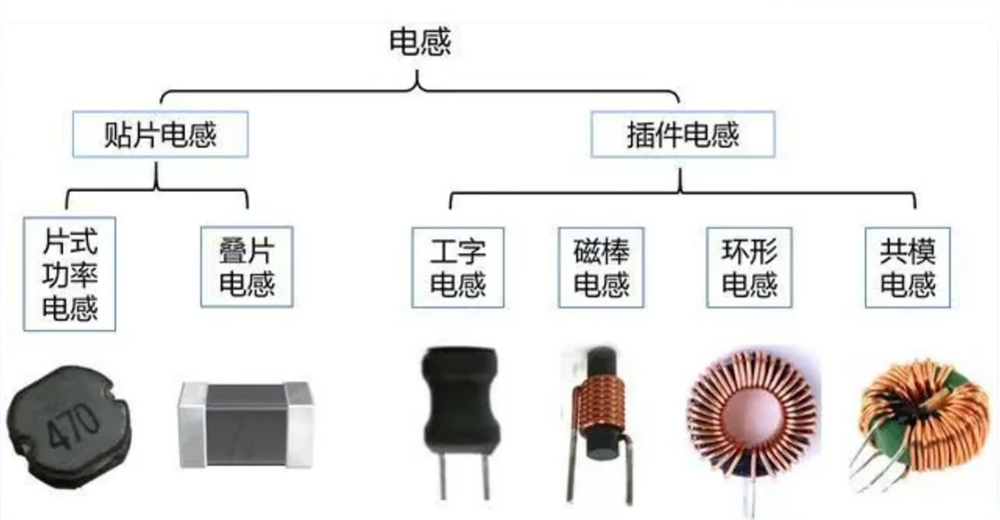

### 4.二极管

- 二极管是用半导体材料（硅、硒、错等）制成的一种电子器件。
- 二极管有两个电极，正极，又叫阳极；负极，又叫阴极，给二极管两极间加上正向电压时，二极管导通，加上反向电压时，二极管截止。二极管的导通和截止，则相当于开关的接通与断开。
- 二极管具有单向导电性能，导通时电流方向是由阳极通过管子流向阴极。
- 二极管是最早诞生的半导体器件之一，其应用非常广泛。特别是在各种电子电路中，利用二极管和电阻、电容、电感等元器件进行合理的连接，构成不同功能的电路，可以实现对交流电整流、对调制信号检波、限幅和钳位以及时电源电压的稳压等多种功能。

**二极管工作时电压电流关系图**：

    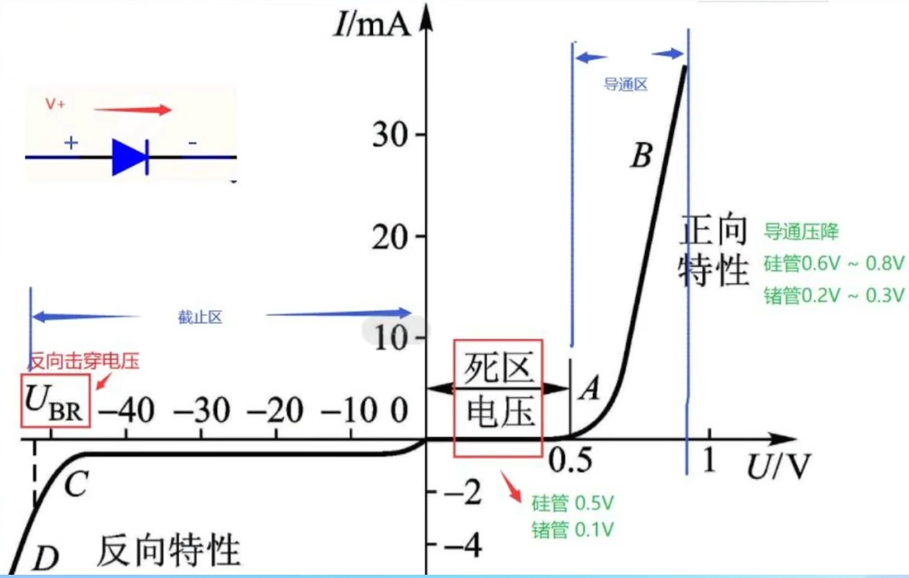

**各种二极管的特性和应用场景**：

    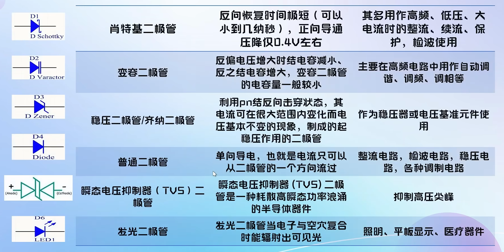

### 5.三极管

- 三极管，全称应为半导体三极管，也称双极型晶体管、晶体三极管，是一种控制电流的半导体器件。其作用是把微弱信号放大成幅度值较大的电信号，也用作无触点开关。
- 三极管是半导体基本元器件之一，具有电流放大作用，是电子电路的核心元件。三极管是在一块半导体基片上制作两个相距很近的PN结，两个PN结把整块半导体分成三部分，中间部分是基区，两侧部分是发射区（发射电荷载流子，负极）和集电区（收集电荷载体，正极），排列方式有PNP和NPN两种。

    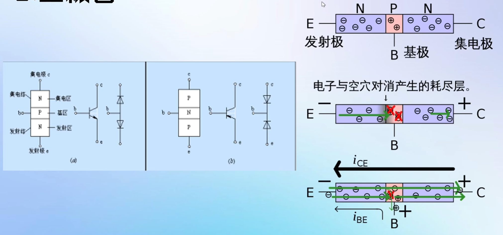

**三极管特性曲线**：

    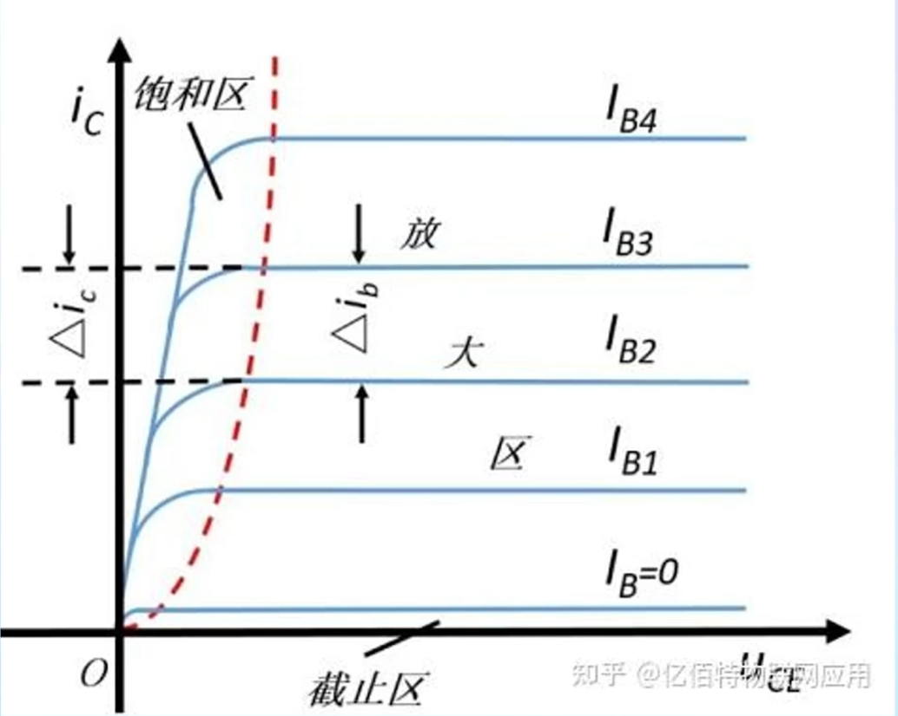

### 6.场效应管

- 场效应晶体管（Field Effect Transistor缩写（FET））简称场效应管。它是利用控制输入回路的电场效应来控制输出回路电流的一种半导体器件。由于它仅靠半导体中的多数载流子导电，又称单极型晶体管，场效应管属于电压控制型半导体器件。具有输入电阻高、噪声小、功耗低、动态范围大、易于集成、没有二次击穿现象、安全工作区域宽等优点。场效应管主要有两种类型：
  1. 结型场效应管（junctionFET一JFET）
  2. 金属-氧化物半导体场效应管（metal——Oxide semiconductor FET,简称MOS-FET）

    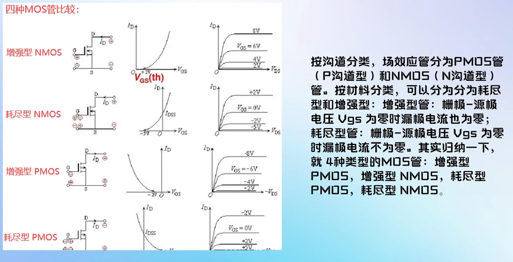

## 元件数据手册

立创商城是一个很好的查找数据手册的地方：https://www.szlcsc.com

### 1. 特性、应用和说明

- 特性部分用于简单了解元件的一些电气特性。
- 应用部分给出元件应用的例子，并给出实例电路图。
- 说明部分给出更详细的元件介绍。

    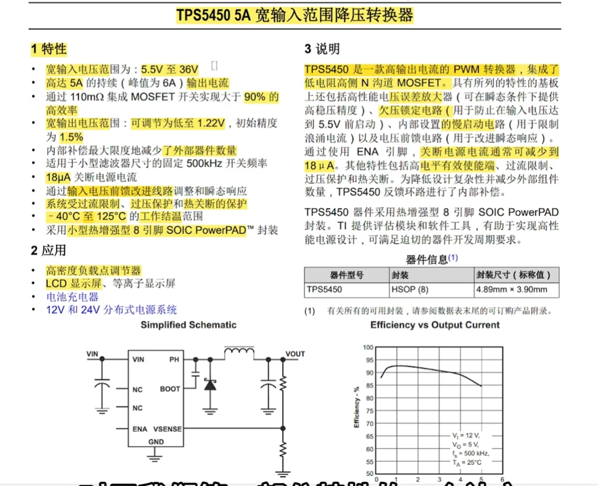

### 2. 引脚配置和功能

- 通常是最重要的部分，给出元件各个引脚的使用说明。

    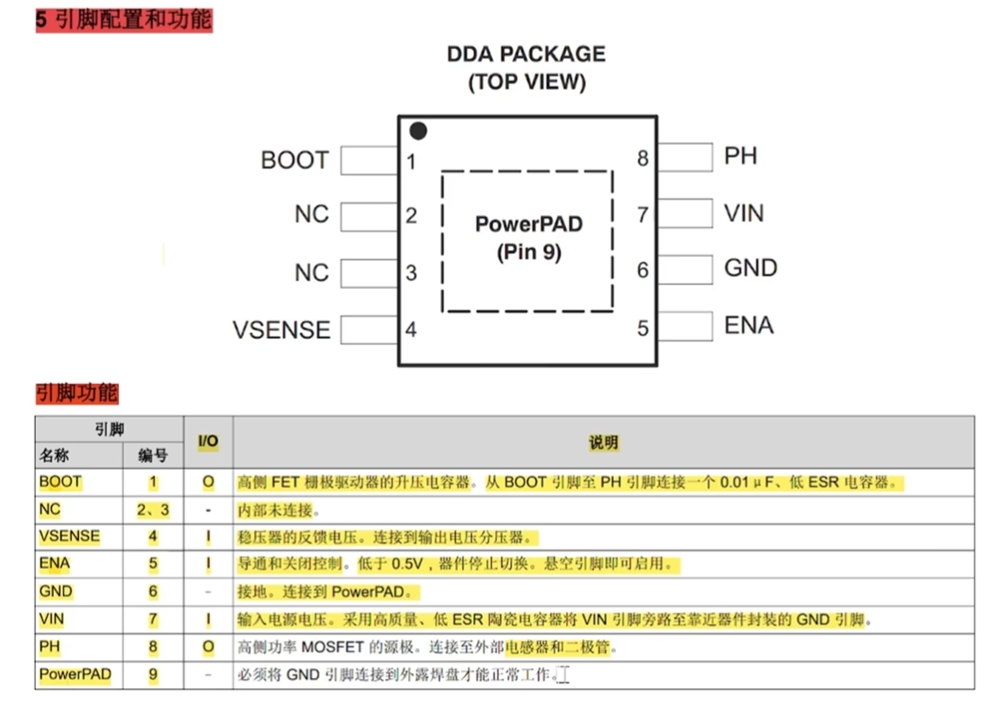

### 3. ---

## 电路定理

### 连接线

- 连线表示的是实际电路中的导线，在原理图中虽然是一根线，但在常用的印刷电路板中往往不是线而是各种形状的铜箔条、铜箔块。

    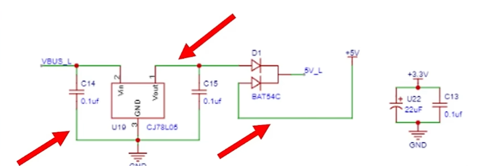

### 结点

- 结点表示几个元件引脚或几条导线之间相互的连接关系。所有和结点相连的元件引脚、导线，不论数目多少，都是导通的。
- 这里的节点一定是电气连接的，在复杂电路中会出现导线在原理图中相交，但交点并非结点。

    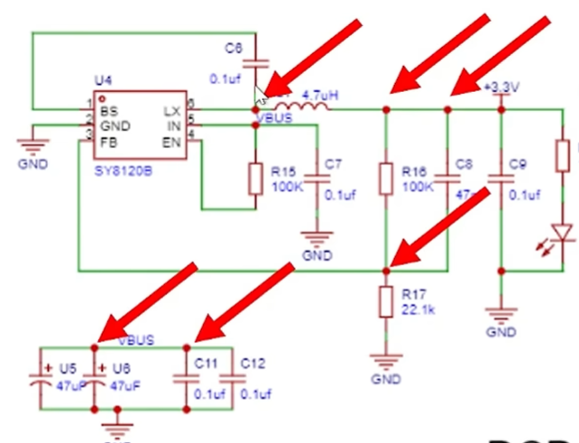

### 网络标签

- 与电路图不同，原理图使用大量的网络标签来简化电路，相同的网络标签之间相互连接。

    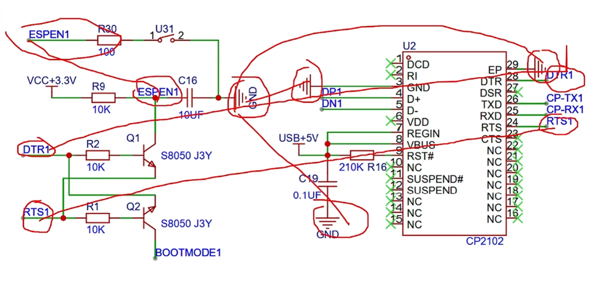

### 基尔霍夫定律

**集总参数电路**：

- 实际电路元件一般都和电能的消耗及电能、磁能的储存有关，它们交织在一起发生在整个元件中。一个实际元件的不同工作条件可以用一到多个理想元件组合表示。

    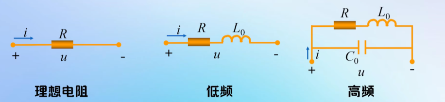

- 假定以上现象可以分别研究，并且这些电磁过程都分别集中在各元件内部进行，这样理想化的元件称为集总参数元件。我们研究集总参数电路中的元件时就不需要考虑他们的相互影响，只需要考虑他们本身的电气特性。
- 用集总参数电路模型来近似地描述实际电路是有条件的，它要求实际电路的尺寸要远小于电路工作时电磁波的波长。

    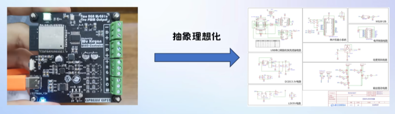

**集总参数电流定律（KCL）**：

- 在集总参数电路中，任意时刻，时任意结点流出（或流入）该结点电流的代数和等于零。
- 推广：KCL可以应用于电路中包围多个结点的任一闭合面

    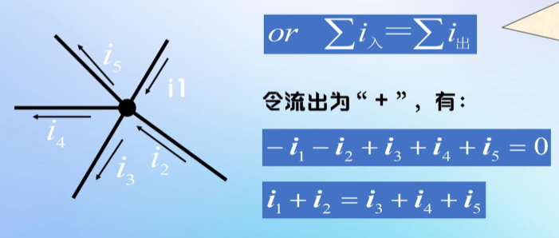

**集总参数电压定律（KVL）**：

- 在集总参数电路中，任一时刻，沿任一回路，所有支路电压的代数和恒等于零。
- 下图中令Ri的电压为Ui，则有：

    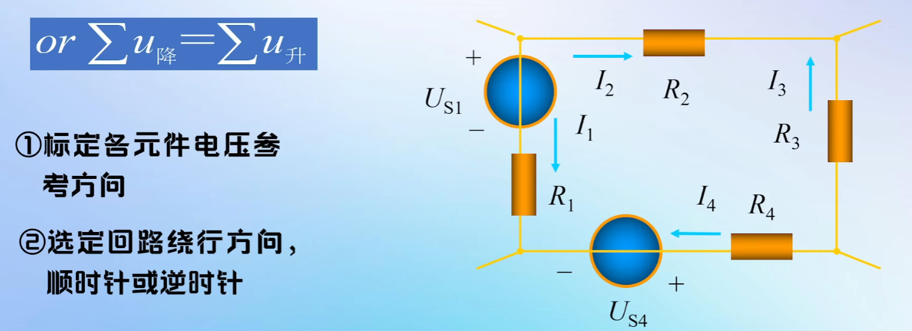

## 看懂原理图

- 原理图四要素：元件符号、连接线、结点、注释，前面已经有了结点和连接线的内容，这里补充注释。
- 总之原理图的设计没有固定标准，有时就是会出现很多乱七八糟的注释之类的，对后续处理工作不是很友好，可能会影响我们对元件名称等内容的确认。

    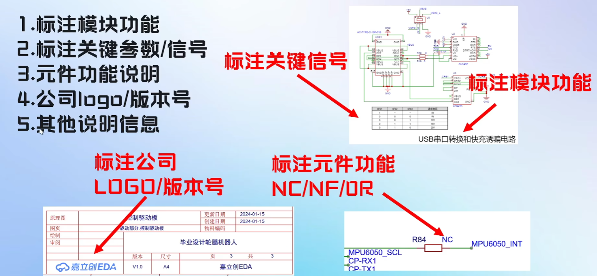

### PCB的物理结构这里暂时不作展开：
- PCB的结构和组成
- PCB叠层结构

### 元件符号与封装

- **元件符号（Symbol）**：元件在原理图中的图形表示，由图形轮廓、引脚（引脚号 pin number + 引脚名 pin name）、位号和参数注释组成，只表达电气连接关系，不表达物理尺寸。
- **元件封装（Footprint）**：元件焊接到 PCB 上时的物理外形与焊盘尺寸，如电阻 `0603`、三极管 `SOT-23`、芯片 `LQFP64`，决定实际占板面积与焊接方式。
- 两者在 EDA 软件中通过器件属性绑定（如立创EDA器件属性中的 Footprint 字段）：原理图阶段用符号描述"电气上是什么、怎么连"，转 PCB 阶段按封装描述"物理上长什么样、怎么摆"。数据手册中的"封装尺寸"章节就是封装信息的权威来源。
- 赛题六中需要理解的"元件符号"信息即：符号上的类别、位号、型号/参数文字与包围盒；"引脚"即引脚号、引脚名与端点坐标。

# 二、问题与解决

- 根据基本的电路内容理解赛题的说明文档，整理任务需求。

# 三、下周计划

- [ ] 开学了，中间日期中断一下。

# 四、总结

